# Course-to-Book Engine

Turn a playlist of recorded lectures into a real book: organised by idea, every fact traceable to the second of video it was said, and rebuildable exactly.

**[Live app](https://coursebook-swart.vercel.app)** · **[Design doc (PDF)](docs/thinking/course-to-book-engine.pdf)** · **[The book (PDF)](docs/books/building-llms-from-scratch-public-lectures-edition.pdf)** · **[Second course, pipeline demo (PDF)](docs/books/build-claude-code-from-scratch-pipeline-demo.pdf)**

## In thirty seconds

- Built from the 22 public lectures of a 43-lecture course: **a 164-page book, 6 chapters, 52,000 words**, plus a web edition where every paragraph links to the second of video it came from.
- **An independent AI evaluator backs 96.5%** of a fresh random sample of its factual sentences (target 95%), finds 1.5 misleading errors per 100 (target at most 2), and misses 4.3% of core ideas (target at most 10%).
- Every flagged sentence was decided by a human reviewer. Running the course's own code caught two numbers the lecture got wrong.
- Nothing course-specific is built in: a second course went through the same commands with a new settings card.
- Anyone can rebuild the identical book from this repository without an API key (see [Rebuild the book yourself](#rebuild-the-book-yourself-no-api-key-needed)).

## Results

| | Building LLMs from Scratch | Build Claude Code from Scratch |
|---|---|---|
| Edition | Public Lectures Edition, **reviewed release** | Pipeline demonstration, **draft, unreviewed** |
| Lectures used | 22 of 43 (21 are members-only on YouTube) | 4 of 4 |
| Book | 164 pages · 6 chapters · 52,243 words | 2 chapters · 8,311 words |
| Facts backed, independent evaluator | **96.5%** (200 sentences × 3 judgements) | 93.0% |
| Misleading errors per 100 | 1.5 | 1.0 |
| Planted false facts caught | 106 / 120 | 32 / 40 |
| Code listings run / numbers confirmed | 37 of 46 / 69 | none (no companion code) |
| Human review | all 372 flagged items decided | 15 items open |

## The problem

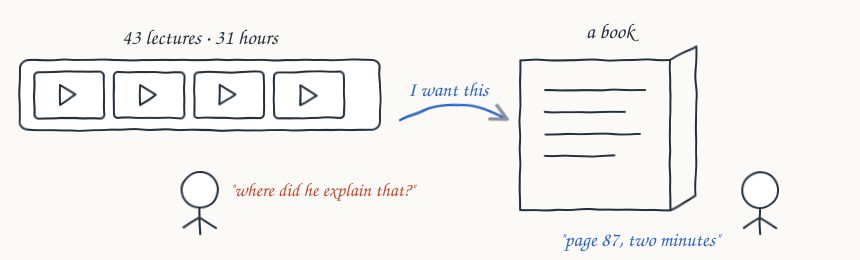

Courses are good for learning in order and bad for looking things up. A book fixes that, but writing one takes weeks, and a book written quickly by an AI model can't be trusted: nothing shows which sentences the lecturer actually said.

## What it builds

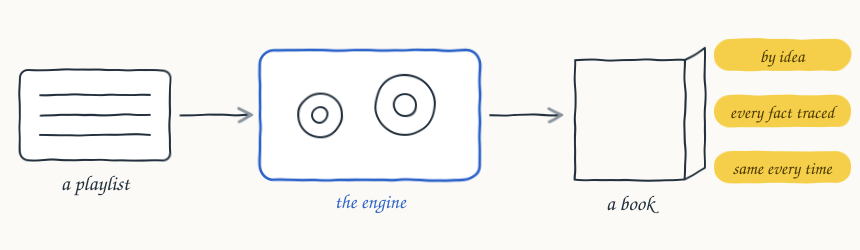

The engine reads a lecture playlist and writes a book with chapters, an introduction, short summaries and diagrams. Three promises hold for every book it makes: it is organised by idea, not by video; every fact can be traced to the second of video it came from; and running it again gives the same book.

## Five trade-offs

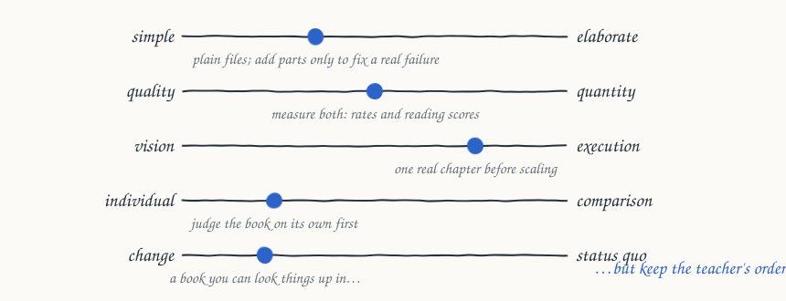

The design stays as simple as the checks allow, measures both numbers and reading quality, proves one real chapter before scaling, judges the book on its own before comparing it with alternatives, and changes how the course is used while keeping how it was taught.

## How it works

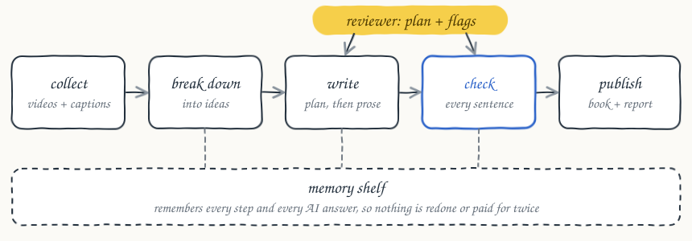

Five steps in a row, the reviewer stepping in at two points, and a memory underneath everything.

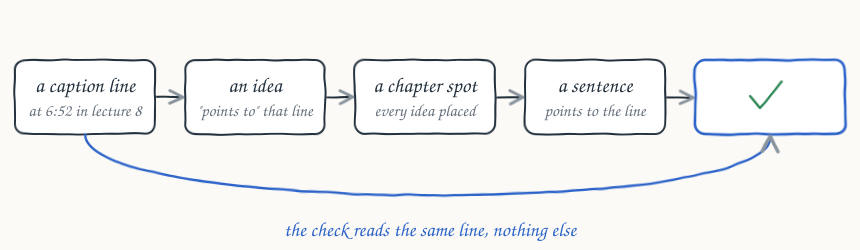

Every caption line gets a label made from its video and the second it starts. Ideas, chapter plans and sentences all point back to those labels. Pick any sentence and you can play the exact moment it came from.

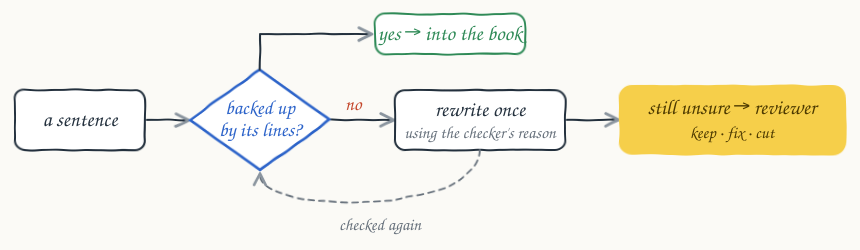

Nothing gets in on the writer's word alone. A sentence is either backed by the lines it points to, fixed until it is, or decided by the reviewer, who can see the evidence. If a later run changes that sentence, the decision is reopened.

## Who decides what

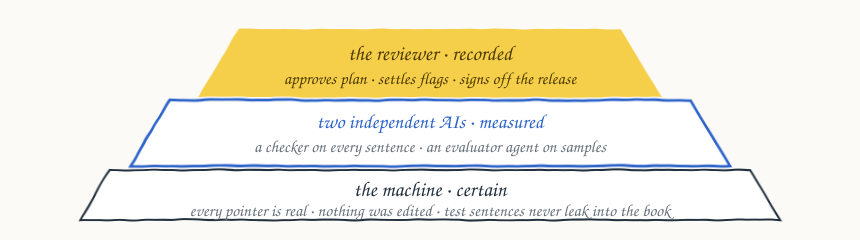

The machine does what it can do with certainty. The AI checker does the reading, and its accuracy is measured with planted false sentences. An independent evaluator agent, a different model that never sees the checker's verdicts, audits samples of the finished book. The reviewer makes the judgement calls. The book states its measured numbers instead of promising perfection.

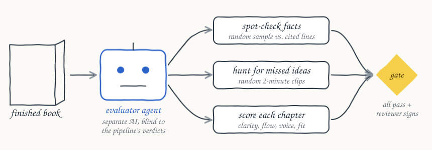

## Diagrams explained on screen

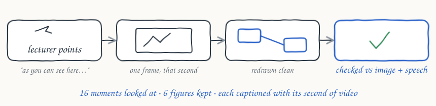

Captions only carry what was said. When a lecture explains a diagram or an equation on the screen, the engine finds the moment the lecturer points at it, grabs one still frame at that second, has an AI with vision redraw it, and checks the redraw against the frame and against what is said. In the first book, 16 moments were read and 6 figures kept. Only a few moments per chapter are sampled, and the step is opt-in because it downloads video.

## Rebuild without paying twice

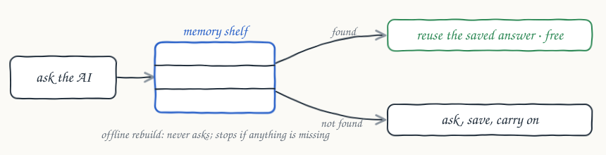

Every AI answer is stored with a fingerprint of what went in. Change one thing and only what depends on it is redone. To share the book without sharing the captions, everything except the raw captions is in [`book-data/`](book-data), with a fingerprint for every file.

### Rebuild the book yourself (no API key needed)

Writing a book calls an AI model, which needs a key. Rebuilding it does not: [`book-data/`](book-data) already holds every answer the AI gave, so anyone can regenerate the identical book with no account, no key and no cost.

Check every file and rebuild the book's sources:

```sh
uv sync --locked
uv run --locked coursebook verify-package --package book-data
```

Also typeset the PDF (needs [Quarto](https://quarto.org)):

```sh
uv run --locked coursebook verify-package --package book-data --pdf --out rebuilt
```

To build a book from a new playlist you do need a model key: see [Setup](#setup).

## Any course, by settings

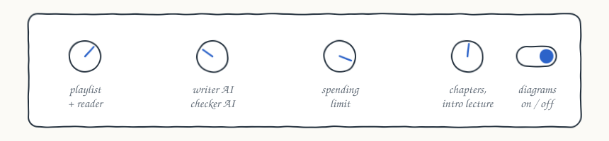

A new playlist needs a new settings card, not new code. The second course above was built with the same commands.

## What went wrong, and what I did

| What happened | What I did |
|---|---|
| **Half the course is behind a paywall.** Every odd-numbered lecture is members-only. | Declared, not hidden: a "Public Lectures Edition, 22 of 43", with each missing lecture listed and its reason. |
| **The lecture said 610 and 107.** Running the course's code gives 6100 and 1107. | The disagreement went to the reviewer with the executed values; the text was corrected, with the code run recorded as the reason. |
| **The evaluator disagreed with itself** on about 10% of sentences between identical runs. | Measured better, never lowered the bar: each sampled sentence is judged three times over 200 sentences. The 95% target never moved. |
| **The coverage check punished a book that teaches each idea once.** | Missing ideas are searched across the whole book before they count. Both numbers are reported: 4.3% from the book, 12.8% near the clip. |
| **Rewrites copied caption mistakes**, e.g. "a Jou activation" for GELU. | Rewordings must use the correct technical term and are re-checked by the strict evaluator before the reviewer sees them. |
| **YouTube rate-limits and blocks cloud servers.** | Each missing lecture records why; capture resumes where it stopped; the live server reaches captions through a signed-in session. |

## Live app

[coursebook-swart.vercel.app](https://coursebook-swart.vercel.app) shows both books with their PDF, web edition and evidence explorer. Pasting a playlist starts a real build on an Azure server; it needs an access code from the owner, takes about 35 minutes for a short course, and comes out as a draft until it is reviewed.

---

## Setup

Python 3.11, [uv](https://docs.astral.sh/uv/getting-started/installation/), and
[Quarto](https://quarto.org) with TinyTeX (`quarto install tinytex`) for the PDF.

```sh
uv sync --locked
uv run --locked pytest -q
cp .env.example .env   # writer + judge deployments and key; never commit .env
```

## Pipeline

```sh
uv run --locked coursebook inventory              # freeze the playlist (order, ids, titles)
uv run --locked coursebook capture --limit 43     # captions -> content-addressed snapshots
uv run --locked coursebook run                    # reader, outline, framing, writing, checks, diagrams,
                                                  #   plant test, reference listings, cross-check
uv run --locked coursebook approve --by "Name"    # reviewer approves the current outline
uv run --locked coursebook review --by "Name"     # reviewer settles flagged sentences and reference conflicts
uv run --locked coursebook evaluate               # independent evaluator agent (grounding, coverage, quality)
uv sync --group listings && uv run --locked coursebook run-code   # execute listings, check stated numbers
uv run --locked coursebook render                 # output/book.pdf, output/html/, output/brief/*.md
uv run --locked coursebook why ch02.s09.p02       # full trail behind any sentence or paragraph
uv run --locked coursebook export                 # book-data/ package without raw captions
uv run --locked coursebook verify-package         # rebuild from book-data/ and compare fingerprints
uv run --locked coursebook status                 # progress, spend vs budget, review queue
```

```
captions -> segment (line IDs) -> extract (teaching points) -> reader (reader.md)
  -> plan + outline (concept chapters; reviewer approval) -> frame (intro, openers, at a glance)
  -> write (tagged, cited sentences) -> verify (judge, one rewrite, review queue)
  -> takeaways -> diagrams (each arrow checked) -> plant test (catch rate)
  -> reference listings (verbatim code) -> cross-check (conflicts to the reviewer)
  -> evaluator agent -> run-code (output + numeric checks) -> render (PDF + web edition + 6W brief)
```

Each stage stores its output with the hash of its inputs and is skipped when the
inputs are unchanged. Every model response is cached by request hash, so
`coursebook run --offline` rebuilds everything with no API calls and fails loudly
on a cache miss.

### The 6W brief (`output/brief/`)

| File | Question | Content |
|---|---|---|
| `reader.md` | who / what | inferred reader contract; every field cites evidence or is `unknown`; the configured brief overrides |
| `coverage.md` | how much | points per lecture placed / dropped / auto-placed; lectures not covered |
| `concept_map.md` | where | lectures → chapters → sections, with a map |
| `learning_path.md` | when | reading order with source minutes; readiness gates |
| `pipeline.md` | how | stages, models, calls, cache use and cost |
| `rationale.md` | why | measured rates against targets; evaluator agent verdict; open release conditions |

### Editions

- `output/book.pdf`: printed book (Quarto + LaTeX), chapter-level sources, appendix with
  per-section minute ranges and a coverage heatmap.
- `output/html/`: web edition; every paragraph has a hover note with its lecture
  timestamps (links jump to that second) and a short caption quote.

## What the guarantees mean

- Citation IDs are checked mechanically; whether a sentence is *supported* is a
  model judgement, measured by the planted-claim test and re-checked on a random
  sample by an independent evaluator agent (a third model, blind to the judge). The book states its measured rates instead of promising zero errors.
- The book is marked DRAFT, with reasons, until the outline is approved, the
  review queue and reference conflicts are settled, the evaluator agent passes,
  stated numbers agree with the executed code, and every lecture is covered or
  declared out of scope by the edition settings (`edition` in `config.json`).
- 21 of the 43 lectures (the odd-numbered ones from 3 to 43) are members-only on
  YouTube; their captions are not publicly retrievable. The book is a declared
  Public Lectures Edition and lists them, with their reason, as not covered.
- Captions are automatic and can be misheard. Raw captions and the model cache stay
  in `data/` (git-ignored) because reuse rights are not established.

## Deploy (public site)

The UI is served by Vercel; builds run on an Azure VM (they take hours and need Quarto, LaTeX, Chrome and PyTorch).
Vercel rewrites `/api/*` and `/books/*` to the VM. The VM reaches Azure OpenAI with its managed identity, so no key
is copied off your machine. Starting a build on the public site needs the access code in `deploy/.build-code`.

    bash deploy/push.sh            # code + built book to the VM, environment, setup (idempotent)
    bash deploy/vercel/build.sh    # front end to Vercel
